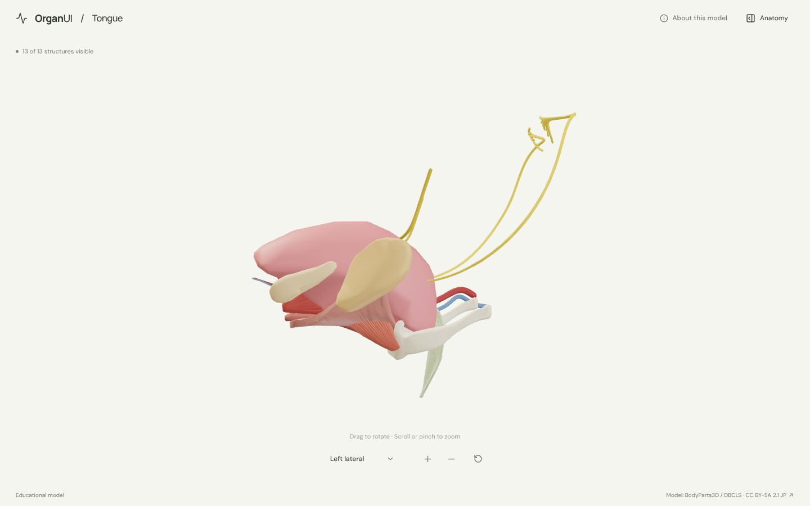
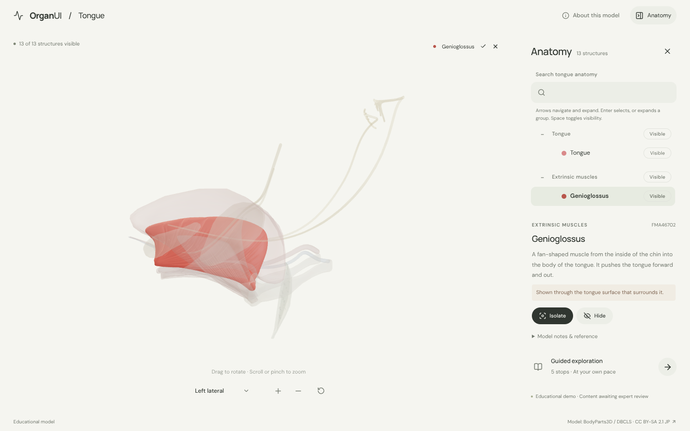
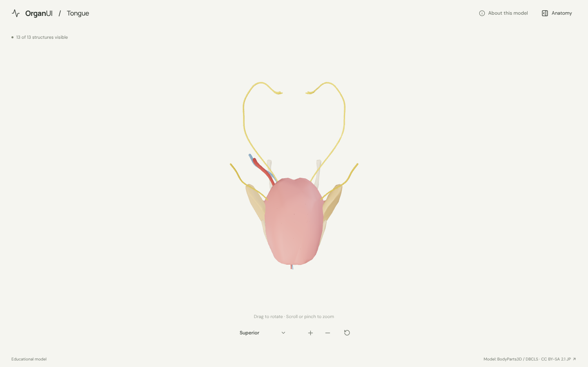
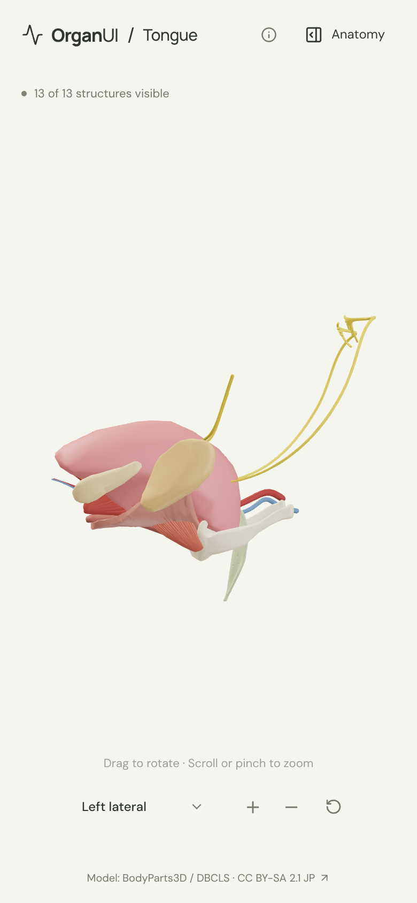

# OrganUI Tongue

A minimal, standalone, open-source tongue anatomy explorer built with React, TypeScript, Three.js, React Three Fiber, Vite, and Bun. It shares its interaction design and code with [OrganUI Heart](https://github.com/organui/heart-3d).

**Status:** working local demo. Thirteen selectable structures from a real, openly licensed model, responsive layouts, and checked desktop/mobile interactions. Public deployment and clinical anatomy review have not been completed.



## Run locally

Install [Bun](https://bun.sh/) **1.4.2 or newer**, then:

```sh
git clone https://github.com/organui/tongue-3d.git
cd tongue-3d
bun install --frozen-lockfile
bun run dev
```

Open **http://127.0.0.1:5173**. No environment variables, accounts, API keys, sibling repositories, model downloads, or external font services are needed after dependency installation. The ready-to-use 1.3 MB GLB is in `public/models/`.

```sh
bun run typecheck       # TypeScript checks, including conversion scripts
bun run test            # Unit tests for selection emphasis, picking, ownership, and the anatomy-tree adapter
bun run verify:model    # Check the GLB hash, source IDs, element lists, and valid geometry
bun run build           # Typecheck and create dist/
bun run preview         # Serve the production build at http://127.0.0.1:4173
bun run format:check    # Check formatting
```

The app is static and uses relative build paths. No deployment has been performed.

## Explore

- The tongue opens in the left lateral view, with its extrinsic muscles, the floor of the mouth, the hyoid bone, epiglottis, salivary glands, nerves and vessels around it. Open **Anatomy** in the header to browse structures.
- Drag to rotate; scroll or pinch to zoom. The view menu has left lateral, anterior and superior presets. Manual rotation changes its label to **Custom view**; zooming and selecting keep the view name.
- Select a mesh or use the anatomy tree (the OrganUI registry `anatomy-tree` component, see [registry integration](docs/REGISTRY_INTEGRATION.md)). The selected structure glows in its own colour and everything else is ghosted, so the genioglossus and the lingual vessels stay visible through the tongue.
- Isolate a structure, hide it, or restore all. **Reset explorer** restores the left lateral camera, visibility, selection, tree state and tour.
- Follow five guided stops, from the tongue and the genioglossus to the hyoid bone, the hypoglossal nerves and the epiglottis.
- Keyboard: Tab/Enter for controls, arrow keys to rotate the focused model, `+`/`-` to zoom, Escape closes the panel and returns focus to its toggle.

<details>
<summary>Selection, superior view and mobile screenshots</summary>







</details>

## Model, credits, and license

> BodyParts3D / Anatomography, © The Database Center for Life Science (DBCLS), licensed under Creative Commons Attribution-Share Alike 2.1 Japan. Adapted by OrganUI.

The model is a curated subset of **BodyParts3D / Anatomography 4.3**: 25 source meshes grouped into 13 structures. The model data and screenshots of it are under **[CC BY-SA 2.1 Japan](https://creativecommons.org/licenses/by-sa/2.1/jp/deed.en)**, separately from this repository's **MIT code license**. Meshes come from a checksum-pinned public mirror and are cross-checked against the official 4.3 concept table. Read [model provenance](docs/MODEL_PROVENANCE.md), [asset attribution](public/models/ATTRIBUTION.md) and the [manifest](public/models/manifest.json).

Descriptions summarise the [StatPearls tongue anatomy chapter](https://www.ncbi.nlm.nih.gov/books/NBK507782/) and general anatomy. **Expert anatomical review is pending.** This is an educational interface demonstration, not a diagnostic or clinical tool.

Known limitations:

- The tongue is one coarse surface. Intrinsic muscles, papillae and the oral and pharyngeal parts cannot be selected separately.
- The styloglossus, palatoglossus, mandible, palate, pharynx and most of the larynx are omitted.
- Lingual vessels are shown on the right side only, because the source has no left-sided meshes. Paired muscles, glands and nerves are grouped into one selectable set each.
- The hypoglossal nerve trunks run up to the skull base, so they reach well beyond the tongue. Colours are illustrative.
- Browser checks used headless Chromium with software WebGL at desktop and phone viewport sizes, not physical devices or a screen-reader audit.

## License

Original application code: [MIT](LICENSE). Anatomy model, derived model images, fonts, and icons retain their separately documented licenses.

Part of [OrganUI](https://github.com/organui).
